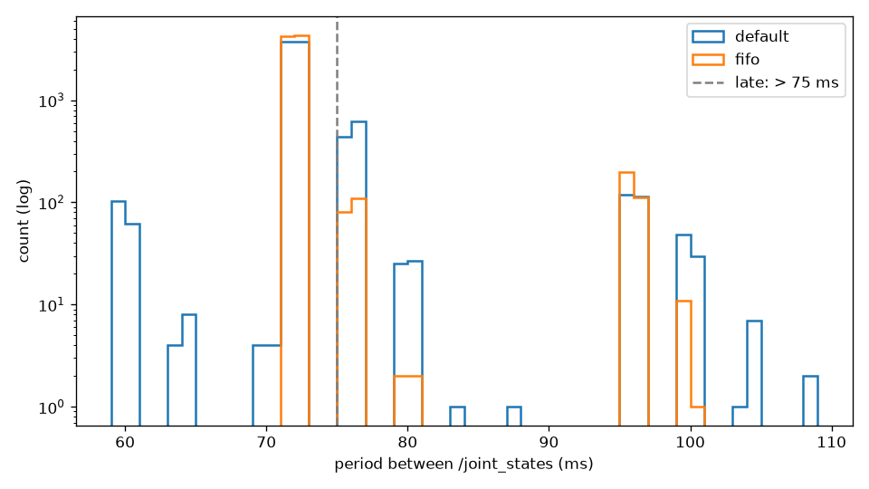
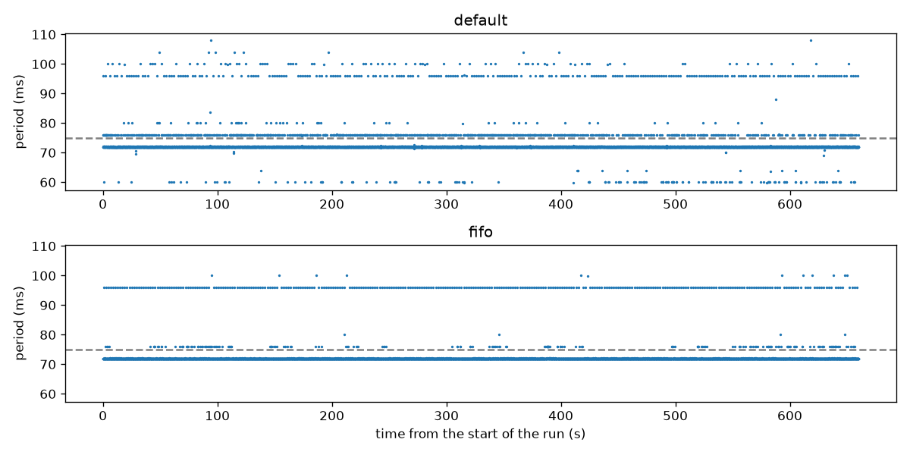

# Timing budget of the real arm

Measured timing of the path from ROS 2 to the myCobot 280 on the Jetson Nano: serial round trip, `/joint_states` rate,
command → motion latency and the effect of `SCHED_FIFO`. Input for the ros2_control `update_rate`
([controllers.yaml](../../ros2_ws/src/braco_description/config/controllers.yaml)) and [ADR-0004](../decisions/ADR-0004-trajectories-through-arm-driver.md).

Architecture: [architecture.md](architecture.md).

**Contents:** [Summary](#summary) · [Serial loop of `arm_driver`](#serial-loop-of-arm_driver) · [Results](#results) ·
[What it means](#what-it-means) · [What would change it](#what-would-change-it) · [Method](#method)

Real arm, Jetson Nano, no desktop (`multi-user.target`), `arm_driver` alone in a `real` container (no
`temperature_monitor`, joystick, camera or page). Results 1–3 measured on **2026-11-09**, result 4 on **2026-11-17**, result 5 on **2026-11-27**.

## Summary

| | Value | Bound by |
|---|---|---|
| Serial round trip, one joint read (`getAngles`) | **9.3 ms** mean, 11.8 ms p99, 13.9 ms max, 0 failures / 2000 | Atom firmware (the wire is 0.22 ms) |
| `/joint_states`, arm idle | **18.7 Hz** at `state_rate_hz` 20; ceiling **~45 Hz** from 60 Hz up | `sleep(10ms)` + read in the serial loop |
| `/joint_states`, continuous commands (the plugin's `write()`) | **~27 Hz** (37 ms) since 2026-11-27 ([result 5](#5-after-the-serial-loop-change)); was ~14 Hz (70 ms) | `command_gap_ms` 25 ms + angle read ~11 ms after every motion command |
| Command → first joint motion (J6, 5°, speed 30) | **~150 ms** p50, 117 ms min, 181 ms max since 2026-11-27; was ~205 ms p50, 140 ms min, 268 ms max | Atom and servos starting the move |
| `/joint_states` under CPU load, default vs `SCHED_FIFO` | p50 72 ms, p99 **96 ms** in both; max 108 → 100 ms | Temperature read every 2 s (p99); waiting for a core (max) |

**Conclusion:** during a trajectory the real arm takes a new command and gives a new position about every **37 ms
(~27 Hz)**, and starts moving **~150 ms** after a command (2026-11-27; before: 70 ms and ~200 ms). Neither depends on `state_rate_hz` or on the controller's
`update_rate`. Keep `update_rate: 100` and `state_rate_hz: 20`; the levers are inside `arm_driver` ([below](#what-would-change-it)).

## Serial loop of `arm_driver`

One thread does all serial work ([arm_driver_node.cpp](../../ros2_ws/src/braco_driver/src/arm_driver_node.cpp), `serialLoop()`):

```
every pass:  [motion command pending?] ── yes ──► sendAngles ─► sleep command_gap_ms (25 ms) ─┐
                      │ no                                                                     │
                      ▼                                                                        ▼
             [state due?] ── yes ──► getAngles ◄──────────── always right after a command ─────┘
                                        │ no reply within 30 ms: skipped
                                        ▼
                                 publish /joint_states ─► [no command sent?] ─► sleep 10 ms
             [every 2 s]  ──────────► getTemps, and half a period later getVoltages (one per pass)
```

While idle, "state due" is every `1 / state_rate_hz` (20 Hz).

| Case | Period of `/joint_states` | Measured |
|---|---|---|
| Idle, `state_rate_hz` low | T + ~5 ms (the loop checks the clock every ~10 ms; the next period counts from the read) | 20 Hz → 18.7 Hz |
| Idle, ceiling | read ~9.3 ms + sleep 10 ms + overhead ≈ 22 ms | ~45 Hz |
| Continuous commands | send + 25 ms gap + read ≈ 35 ms predicted | **37 ms** (2026-11-27). 70 ms with the 50 ms gap: the extra ~10 ms was `tcdrain` after the send, not the read |

## Results

### 1. Serial round trip

`scripts/timing/serial_rtt.py`: 1000 × `getAngles` (request `FE FE 02 20 FA`, 17-byte reply) at 1 000 000 baud on
`/dev/ttyTHS1`, `arm_driver` stopped.

| Pause between reads | Reads | Mean ms | p50 ms | p99 ms | Max ms | Failed |
|---|---|---|---|---|---|---|
| 5 ms | 1000 | 9.34 | 9.27 | 11.83 | 13.87 | 0 |
| 0 ms | 1000 | 8.33 | 8.22 | 11.86 | 13.96 | 0 |

22 bytes at 1 Mbaud take 0.22 ms: ~97 % of the round trip is the Atom answering. A higher baud rate would not help.

### 2. `/joint_states` rate

`scripts/timing/js_rate.py`: 60 s per point, intervals from `header.stamp`. *Load* = `scripts/timing/hold_load.py`
sending `ALL_ANGLES` of the current pose at the same rate as `state_rate_hz`, as the plugin's `write()` does
(ADR-0004); the arm holds still. CPU: `arm_driver`, % of one core.

| `state_rate_hz` | Load | Achieved Hz | Achieved / requested | Mean ms | p50 ms | p99 ms | Max ms | CPU % |
|---|---|---|---|---|---|---|---|---|
| 20 | idle | 18.7 | 94 % | 53.4 | 52.7 | 60.7 | 76.5 | 5 |
| 20 | commands | 14.4 | 72 % | 69.4 | 71.0 | 91.2 | 98.2 | 11 |
| 30 | idle | 25.5 | 85 % | 39.2 | 41.1 | 52.0 | 60.0 | 7 |
| 30 | commands | 14.1 | 47 % | 70.7 | 71.9 | 95.5 | 100.3 | 12 |
| 40 | idle | 31.4 | 79 % | 31.9 | 32.0 | 52.0 | 56.2 | 5 |
| 40 | commands | 14.0 | 35 % | 71.3 | 71.8 | 94.7 | 99.9 | 12 |
| 50 | idle | 40.3 | 81 % | 24.8 | 23.9 | 39.9 | 56.1 | 5 |
| 50 | commands | 14.2 | 28 % | 70.6 | 71.5 | 95.3 | 99.4 | 14 |
| 60 | idle | 45.9 | 77 % | 21.8 | 20.1 | 39.7 | 47.8 | 6 |
| 60 | commands | 14.0 | 23 % | 71.3 | 71.8 | 95.5 | 98.6 | 16 |
| 60 (repeat) | idle | 44.5 | 74 % | 22.5 | 23.8 | 40.0 | 52.1 | 6 |
| 60 (repeat) | commands | 14.3 | 24 % | 70.0 | 71.2 | 92.4 | 100.3 | 16 |
| 70 | idle | 45.0 | 64 % | 22.2 | 21.4 | 42.4 | 48.2 | 6 |
| 70 | commands | 14.1 | 20 % | 70.8 | 71.4 | 94.8 | 98.6 | 16 |
| 90 | idle | 44.5 | 49 % | 22.5 | 23.8 | 39.8 | 48.0 | 6 |
| 90 | commands | 14.1 | 16 % | 70.8 | 71.0 | 96.3 | 98.3 | 17 |
| 100 | idle | 45.4 | 45 % | 22.0 | 20.5 | 39.7 | 48.0 | 6 |
| 100 | commands | 14.2 | 14 % | 70.5 | 70.6 | 96.0 | 101.2 | 19 |

- Idle: the rate follows the request up to ~50 Hz, then stays at ~45 Hz.
- Commands: ~14 Hz whatever the request. Commands above that rate are overwritten before they are sent (latest wins)
  and only cost CPU (11 → 19 %).
- p99 / max idle (~40 / ~48 ms at the ceiling): the temperature and voltage reads every 2 s.
- Read failures: one `no valid angle feedback` right after each `power on`, none during the runs.
- *Commands* is a stand-in for the plugin's `write()`, not re-run with it yet: re-run `js_rate.py` and
  `latency_step.py` with the real plugin.

### 3. Command → motion latency

`scripts/timing/latency_step.py`: J6 +5° and back, 20 steps per point, speed 30, the target resent at `state_rate_hz`.
Latency = `header.stamp` of the first `/joint_states` with J6 more than 0.5° from where it was, minus the time of the
step's first command.

| `state_rate_hz` = command rate | Steps | Min ms | p50 ms | Max ms | Not seen |
|---|---|---|---|---|---|
| 20 | 20 | 145 | 209 | 268 | 0 |
| 30 | 20 | 140 | 208 | 232 | 0 |
| 40 | 20 | 144 | 206 | 239 | 0 |
| 50 | 20 | 153 | 207 | 234 | 0 |
| 60 | 20 | 145 | 205 | 241 | 0 |
| 70 | 20 | 141 | 200 | 225 | 0 |
| 80 | 20 | 149 | 204 | 236 | 0 |
| 90 | 20 | 140 | 204 | 229 | 0 |
| 100 | 20 | 146 | 200 | 236 | 0 |

| Part of the latency | Best case (≈ min) | Average (≈ p50) |
|---|---|---|
| Wait for the serial loop (a new command can arrive during the previous one's `COMMAND_GAP`) | 0 | ~35 |
| `sendAngles` + `COMMAND_GAP` + next read | ~60 | ~60 |
| Atom and servos until the joint has moved 0.5° | **X** | **X** |
| Quantization (the motion shows at the next read, every ~70 ms) | 0 | ~35 |
| **Measured** | **140** → X ≈ 80 | **205** → X ≈ 75 |

Both columns give the same servo reaction (~75–80 ms), so the model fits. The rate does not change the latency: the
loop is saturated by commands at every rate tested. With 20 steps p99 equals the max.

### 4. SCHED_FIFO under CPU load

`js_rate.py` under two loads at once: commands (`hold_load.py --rate 20`) and all four cores busy (`yes` × 4 on the
host), 660 s per run, `state_rate_hz` 20. The two runs differ only in the scheduler. The raw CSVs are not kept
(step 5 of [Method](#method) makes them again).

| Run | Msgs | Hz | Mean ms | p50 ms | p99 ms | Max ms | > 75 ms |
|---|---|---|---|---|---|---|---|
| default (CFS) | 9019 | 13.7 | 73.2 | 72.0 | 96.1 | 108.0 | 15.8 % |
| `SCHED_FIFO` 80 | 9049 | 13.7 | 73.0 | 72.0 | 96.0 | 100.0 | 5.7 % |




- Same rate, mean and p99: the period is set by `COMMAND_GAP` and the Atom's reply.
- Without FIFO, 18 % of the periods leave the normal 72 ms, mostly by one 4 ms step (76 ms); with FIFO, 6 %. The waits
  for a core are frequent but small, so the mean and the p99 do not change.
- The ~96 ms band in both runs is the temperature and voltage read every 2 s. FIFO cannot remove it; it sets the p99.

### 5. After the serial loop change

2026-11-27, real arm, Jetson Nano, `arm_driver` alone in a `timing` container (`make down` first), `state_rate_hz` 20,
`command_gap_ms` 25, angles read right after every motion command, a read with no reply skipped after 30 ms.
*Load* = `hold_load.py` at the given rate. One run each.

`/joint_states` rate (`js_rate.py`, 60 s):

| Case | Hz | Mean ms | p50 ms | p99 ms | Max ms |
|---|---|---|---|---|---|
| Idle | 18.4 | 54.3 | 54.0 | 61.7 | 64.8 |
| Load 100/s, `tcdrain` after every send | 20.8 | 48.0 | 48.0 | 60.1 | 114.3 |
| Load 100/s, no `tcdrain` after a motion command | **26.8** | 37.3 | 36.0 | 52.1 | 111.5 |
| Same, second run | **26.8** | 37.2 | 36.0 | 52.0 | 229.7 |

Latency (`latency_step.py`, 20 steps):

| Load | `tcdrain` after a motion command | Min ms | p50 ms | p99 ms | Max ms | Not seen |
|---|---|---|---|---|---|---|
| 20/s | yes | 146 | 157 | 187 | 187 | 0 |
| 100/s | yes | 138 | 162 | 185 | 185 | 0 |
| 100/s | **no** | 117 | **150** | 181 | 181 | 0 |

Where the time goes, under load 100/s:

| Part | Mean ms | How it was measured |
|---|---|---|
| `getAngles` alone, arm still | 8.6 (p99 11.3) | serial script, 300 reads, no `arm_driver` |
| `getAngles` right after a `sendAngles` | 8.4 (p99 9.9) | same, J6 ±5° |
| `sendAngles` + `tcdrain` | p50 1.2, p99 13.2 | same: `tcdrain` sometimes waits ~13 ms for 0.2 ms of data |
| `arm_driver`: send + gap / read + publish / rest | 25.4 / ~11 / 0.4 | timers in `serialLoop()`, without `tcdrain` after the send |

- The Atom answers as fast right after a command as when still: the extra time under load was `tcdrain`, not the Atom.
- The read inside `arm_driver` (~11 ms) is ~2.5 ms slower than the script's: likely the `tcdrain` after the request.

## What it means

| For | Consequence |
|---|---|
| `update_rate` | 100 Hz stays. The controller runs at any rate; the arm gets a new setpoint and gives a new position every ~37 ms, so `read()` sees fresh data about one cycle in four. Lowering it would not change the arm, only the controller's CPU (not measured here) |
| `JointTrajectoryController` on the real arm | Tolerances must allow ~200 ms of lag and 70 ms steps: no tight `path_tolerance`, `goal_time` ≥ 0.5 s |
| ADR-0004 | Setpoints are thinned to **~27 Hz** (was ~14 Hz) |
| Watchdog | `command_timeout_ms` 300 vs 37 ms between commands under load: 8× margin |
| `state_rate_hz` | 20 stays. Higher helps only while idle, where no client needs it |
| Joystick `state_timeout_ms` 150 | Under commands `/joint_states` comes every ~37 ms, but one run had a 230 ms gap: above 150 ms a jog can pause once. Cause not confirmed (likely a lost read plus a temperature read in one pass) |
| `SCHED_FIFO` | Not enabled: it removes the small waits for a core, not the 2 s temperature read ([below](#sched_fifo)) |

### SCHED_FIFO

**Not enabled.** The worst case without it (108 ms) is far below the watchdog (300 ms) and the joystick's state
timeout (150 ms), and a real-time process that stops sleeping can starve the Jetson. Revisit if the Jetson gets more
load or the worst case nears 150 ms.

To enable it: the containers already have `cap_add: SYS_NICE` and `ulimits: rtprio`
([docker/compose.yml](../../docker/compose.yml)); start `arm_driver` with `chrt -f 80` and check that
`ps -eLo tid,cls,rtprio,comm` shows `FF 80`.

Limits of the measurement: one run each; the period is the `/joint_states` stamp interval, a proxy for the loop;
`js_rate.py` reported 1 % CPU for `arm_driver` under load, not explained.

### What would change it

Inside `arm_driver` (measure again with the same scripts):

1. **The command gap**, the main cost under commands. Changed on 2026-11-27: `command_gap_ms` 25 ms (was 50), angles
   read right after every motion command, a read with no reply skipped after 30 ms, no `tcdrain` after a motion
   command ([result 5](#5-after-the-serial-loop-change)).
2. **`tcdrain` after the angle request**: likely ~2.5 ms of the ~11 ms read. Not changed yet.
3. **`sleep(10ms)`** when no command was sent: half of the idle ceiling.
4. Temperature and voltage reads every 2 s: the idle p99 / max.

## Method

```bash
make down                                                    # host: free the serial port
cd docker && COMPOSE_PROFILES=jetson docker compose run --rm --name timing real bash    # terminal A
docker exec -it timing ros_entrypoint.sh bash                # terminal B, in /opt/braco/scripts/timing
```

1. Serial (A, no `arm_driver`): `python3 serial_rtt.py -n 1000` and `--gap-ms 0`.
2. `arm_driver` (A): `ros2 run braco_driver arm_driver --ros-args -p state_rate_hz:=<F>.0` (a double; read only at
   configure, so restart it, or cleanup and configure again, for each F), then `ros2 lifecycle set /arm_driver
   configure` and `activate`. B: `ros2 run braco_bringup zero` once.
3. Rate (B), per F: `js_rate.py --label idle`, then `hold_load.py --rate F` with `js_rate.py --label load` (60 s each).
4. Latency (B), per F: `latency_step.py --requested F --rate F --n 20`.
5. `SCHED_FIFO`, F = 20: host `for i in 1 2 3 4; do timeout 720 yes > /dev/null & done`; B
   `hold_load.py --rate 20 --duration 690` and, 10 s later,
   `js_rate.py --requested 20 --label <run> --duration 660 --raw /ws/bags/timing/<run>.csv`. Once with the plain
   `arm_driver`, once with it started as `chrt -f 80 ros2 run braco_driver arm_driver …`. Plots:
   `plot_jitter.py --requested 20 --run default=<csv> --run fifo=<csv> --out <folder>`.
6. B: `ros2 run braco_bringup park`; host: `make up`.

Results are written to `ros2_ws/bags/timing/` (git-ignored); only the `SCHED_FIFO` plots are kept, in
[timing/sched-fifo/](timing/sched-fifo/).
