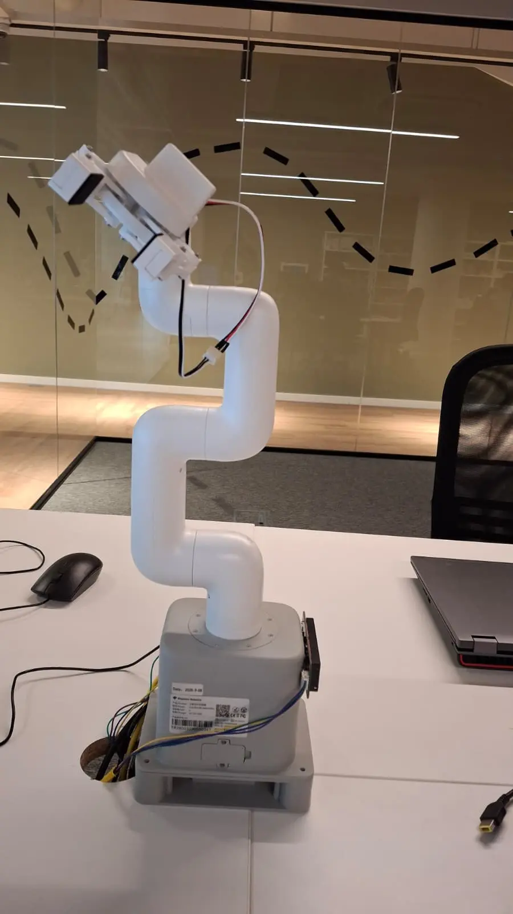
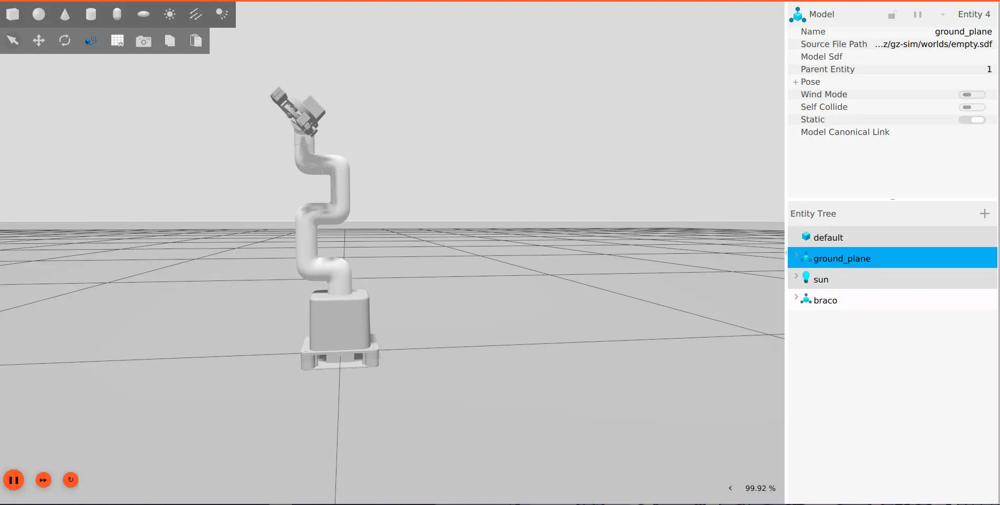
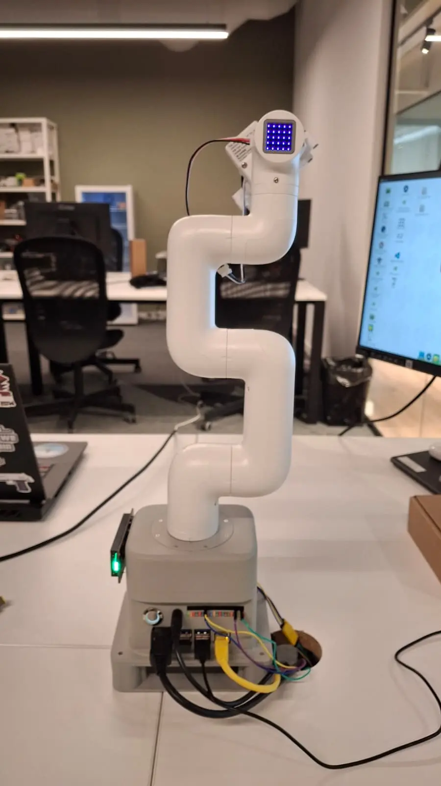
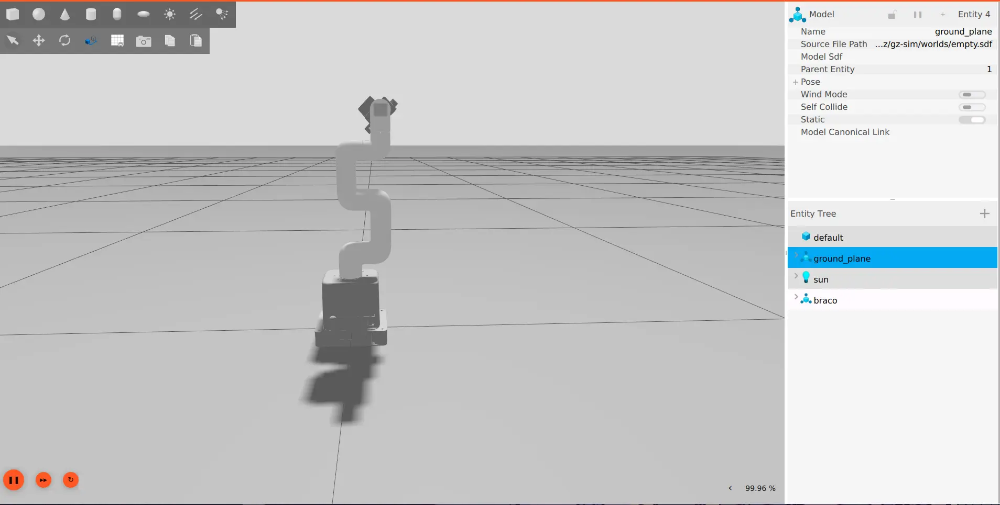

# Arm URDF: sim-to-real validation (issue #25)

Package: `ros2_ws/src/braco_description/` (model of the myCobot 280 with the adaptive gripper and the camera mount).
This document says where the model came from, what was changed, what is **already validated** and what **still has to be
measured on the hardware** (section "Open items"). Nothing below marked "to measure" was made up: those are placeholder values.

## How to use

```bash
# PC (pc-dev container, with X11): the model in Gazebo, holding its pose (gui:=false: server only)
ros2 launch braco_description gazebo.launch.py

# Put the simulated arm at given joint angles (radians, reached in 2 s)
ros2 topic pub --once /arm_controller/joint_trajectory trajectory_msgs/msg/JointTrajectory \
  "{joint_names: [joint1, joint2, joint3, joint4, joint5, joint6],
    points: [{positions: [0.0, 0.0, 0.0, 0.0, 0.0, 0.0], time_from_start: {sec: 2}}]}"

# Check the model without ROS running:
xacro urdf/braco.urdf.xacro > /tmp/braco.urdf && check_urdf /tmp/braco.urdf
```

Tests: `make test` (`test/test_urdf.py`, 16 cases). They fail if a limit changes in `mycobot.hpp` without changing in the
URDF, if a joint name leaves `joint1..joint6`, if a link with geometry has no positive mass/inertia, if a frame (`tool0`,
`tcp`, `camera_optical_frame`) disappears, or if the position of `tool0` in the zero pose changes by accident.

## Origin of the model and what was changed

Base: [elephantrobotics/mycobot_ros2](https://github.com/elephantrobotics/mycobot_ros2), branch `humble`: `mycobot_description`,
variant `mycobot_280_jn` + `adaptive_gripper` for the model
(BSD-2-Clause license, copied to `meshes/LICENSE.elephantrobotics`; the `.dae` meshes are the vendor's, ~26 MB).

| Change | Reason |
|---|---|
| Joints renamed from `joint2_to_joint1 ... joint6output_to_joint6` to `joint1..joint6` | `arm_driver` publishes `/joint_states` with `joint1..joint6`. With different names `robot_state_publisher` ignores the states **without any error** and the model never moves. |
| Links renamed to `base_link`, `link1..link6` | The vendor also names the links `joint1..joint6` (easy to confuse with the joints). |
| Vendor XML error fixed (`lower = "-2.932"1`) | The original file does not even parse. |
| Limits taken from `JOINT_LIMITS` in `ros2_ws/src/mycobot_cpp/includes/mycobot.hpp` | `<limit>` = `JOINT_LIMITS` (the firmware limit minus 1-2°, the same one `sendAngles` applies). There is only one set of limits in the code, so there is no `<safety_controller>`. |
| `inertial` and `collision` added | The vendor only has `visual`. A positive inertia is required by Gazebo/MoveIt. |
| Gripper mounted with `pi/2` instead of `1.579` | The vendor value is ~0.5° off 90°. |
| Flange and everything on it turned -45° about the joint 6 axis (`flange_yaw` in `braco.urdf.xacro`) | Compared with the real arm at joint 6 = 0, the flange's LEGO hole grid (and so the gripper pinned to it) was 45° off in the vendor model. Turns the flange mesh and `tool0`, so the gripper, `tcp` and camera frames follow; positions do not change. |
| Fingers **fixed** (open) by default | The driver does not publish the gripper state yet. With `gripper_actuated:=true` the vendor linkage is used (1 master joint + 5 `mimic`). |

The joint origins and the mesh offsets are the vendor's, unchanged.

The table-clearance check (`minHeightMm()` in `ros2_ws/src/mycobot_cpp/srcs/mycobot.cpp`) was fixed. It used the joint origins of the
**M5** arm (J1 0.13156 m above a short base) with the 140 mm height of the Jetson casing top, so every height it
computed was about 85 mm too high (arm straight out sideways: 96 mm instead of 11 mm, allowed instead of refused).
It now uses the Jetson Nano origins of this URDF from the bottom of the casing (`BASE_HEIGHT_MM - CASING_HEIGHT_MM`);
`test_urdf.py` fails if the C++ joint origins or base height drift from the URDF.

## Frame tree

```
world -> g_base -> base_link -> link1 -> link2 -> link3 -> link4 -> link5 -> link6 -> tool0
                                                                                        |-- tcp
                                                                                        |-- camera_mount -> camera_link -> camera_optical_frame
                                                                                        `-- gripper_base -> gripper_left2 / gripper_right2
                                                                                                            gripper_left3 -> gripper_left1
                                                                                                            gripper_right3 -> gripper_right1
```

- `world`: the table surface.
- `g_base`: the G-shape base, a 150 x 110 mm plate clamped to the table with its black grip. Mesh from the vendor
  (`mycobot_280_pi/G_base.dae`), turned 90° so its long side runs along y like the Jetson casing; collision is a box
  of the same size.
- `base_link`: the bottom of the Jetson casing, in the plate's pocket: `g_base_height` = 0.030 m above the table.
  **Measured**: table to the top of the casing = 140 mm (`BASE_HEIGHT_MM`), minus the 109.7 mm casing
  (`CASING_HEIGHT_MM`) = 30.3 mm; the vendor mounts it at 30 mm.
- `tool0`: the flange, z axis pointing out of it (REP-103); `link6` turned by `flange_yaw` (-45°) so x and y follow
  the flange's hole grid.
- `tcp`: on the z axis of `tool0`, at `tcp_length` = 0.130 m (from `TOOL_LENGTH_MM`: flange to the tip of the closed
  gripper with camera). **Placeholder**: measure to the middle of the fingertips.
- `camera_mount`: the camera plate, Elephant Robotics' **camera flange** (in the arm's box, `docs/inventory`), an
  83 × 34 mm plate, 16 mm thick with the USB camera. Its LEGO hole grid goes on the flange's, and the gripper pins onto
  the same holes on its front face: **flange → camera plate → gripper** (the gripper is 16.3 mm further out than on a
  bare flange). Mesh and mount are the vendor's (`mycobot_280_pi/camera_flange.dae`,
  `mycobot_280_pi_with_camera_flange.urdf`); its direction (`tool0` +x) matches the real arm's front and back photos at
  the zero pose (`camera_flange` photos in `docs/inventory`).
- `camera_link`: on the lens, from the vendor mesh: **(41.5, 0, 12) mm in `tool0`**, looking along `tool0` +z like the
  gripper (`camera_link` x = `tool0` z, REP-103). The roll of the image about the viewing axis is not known from the
  model: the hand-eye calibration sets it.
- `camera_optical_frame`: z forward, x right, y down (rotation `-pi/2, 0, -pi/2` from `camera_link`).

Frame tree PDFs (in [`urdf-sim-to-real/`](urdf-sim-to-real/)):

- [`urdf_tree.pdf`](urdf-sim-to-real/urdf_tree.pdf): links and joints of the URDF
  (`xacro urdf/braco.urdf.xacro > /tmp/braco.urdf && urdf_to_graphviz /tmp/braco.urdf braco_urdf_tree`)
- [`tf_frames.pdf`](urdf-sim-to-real/tf_frames.pdf): the live TF tree with Gazebo running (`ros2 run tf2_tools view_frames`)

## Limits

All in degrees (the URDF uses radians; the test checks the conversion).

| Joint | `JOINT_LIMITS` (`<limit>`) | Velocity limit (measured, speed 100) | Effort limit (approximation) |
|---|---|---|---|
| joint1 | -166 .. 166 | 2.64 rad/s (151°/s) | 1.9 N·m |
| joint2 | -138 .. 138 | 2.44 rad/s (140°/s) | 1.9 N·m |
| joint3 | -149 .. 149 | 2.72 rad/s (156°/s) | 1.2 N·m |
| joint4 | -149 .. 149 | 2.69 rad/s (154°/s) | 0.7 N·m |
| joint5 | -153 .. 158 | 2.65 rad/s (152°/s) | 0.6 N·m |
| joint6 | -178 .. 178 | 2.60 rad/s (149°/s) | 0.6 N·m |

### Measured joint speed per firmware speed setting

`sim_to_real.py velocity`: each joint swept from -A to +A (J1 and J6 ±90°, J2 ±45°, J3 to J5 ±60°) with the other
joints at 0, timed from `/joint_states` (20 Hz) over the middle 80 % of the sweep (leaves out the acceleration and the
final approach). rad/s, peak in brackets:

| Joint | speed 25 | speed 50 | speed 75 | speed 100 |
|---|---|---|---|---|
| joint1 | 0.66 (0.72) | 1.33 (1.42) | 1.99 (2.06) | 2.64 (2.70) |
| joint2 | 0.67 (0.75) | 1.39 (1.72) | 2.09 (3.70) | 2.44 (2.89) |
| joint3 | 0.66 (0.72) | 1.34 (1.45) | 2.01 (2.09) | 2.79 (2.72) |
| joint4 | 0.67 (0.71) | 1.34 (1.40) | 2.06 (2.06) | 2.69 (2.78) |
| joint5 | 0.66 (0.76) | 1.33 (1.39) | 2.01 (2.13) | 2.65 (2.73) |
| joint6 | 0.65 (0.70) | 1.24 (1.43) | 2.00 (2.02) | 2.60 (2.72) |

- **The speed setting is linear:** about **0.0265 rad/s (1.5°/s) per speed unit** on every joint, up to about 2.6 to
  2.8 rad/s at 100. joint2, which carries the whole arm, is the slowest at speed 100 (2.44).
- The URDF `velocity` limit is the speed-100 value per joint. joint3's 2.79 average is above its 2.72 peak, which
  cannot be: the fast 120° sweep lasts about 0.6 s, so the 20 Hz joint states give about ±8 % timing resolution. The
  lower value (2.72) is used. Peaks come from two samples, so single outliers (joint2 at speed 75: 3.70) are noise.

`effort` is an **approximation**. Elephant Robotics does not publish the joint servos' torque (the spec pages list
payload, reach and joint ranges only; the one servo table in the 2021 user manual, 0.44 N·m stall, is a micro servo
too weak to hold the arm, most likely the gripper's). So each joint's limit is the lower bound the published spec
implies: the static torque to hold the arm (masses below, with the camera plate) **plus the rated 0.25 kg payload at
`tcp`**, in the joint's
worst pose (a grid of J2..J5 from -90 to +90°), rounded up:

| | J1 | J2 | J3 | J4 | J5 | J6 |
|---|---|---|---|---|---|---|
| Arm only (N·m) | 0 | 0.93 | 0.47 | 0.22 | 0.13 | 0.01 |
| Arm + 0.25 kg payload (N·m) | 0 | 1.89 | 1.15 | 0.67 | 0.57 | 0.01 |
| **Effort limit in the URDF (N·m)** | 1.9 | 1.9 | 1.2 | 0.7 | 0.6 | 0.6 |

J1 (vertical axis) and J6 (the payload is on its axis) carry no gravity load and take their neighbour's value. Checked in
Gazebo: the arm holds itself stretched out (J2 ±90°) and makes fast moves (J2 through 90° in 0.7 s). The first
placeholder (1.0 N·m for every joint, with the old 0.1 kg per link) made the Gazebo arm collapse at J2 -45°.

## Inertia

No scale was available, so the masses come from documented totals:

| Item | Value in the model | Source |
|---|---|---|
| Gripper, total | **0.110 kg** | **documented**: myCobot Adaptive Gripper, 110 g on retailer spec sheets ([OpenELAB](https://openelab.com/products/elephant-robotics-mycobot-adaptive-gripper), [robu.in](https://robu.in/?p=2097029)); the same listings give the 110 × 90 × 60 mm and 150 g clamp printed on our gripper's label |
| `gripper_base` / 6 finger parts | 0.080 kg / 0.005 kg each | split **estimated** (the body holds the servo) |
| Whole arm (`base_link` + `link1..link6`) | **1.03 kg** | **documented**: myCobot 280 Jetson Nano spec sheet ([Qviro](https://qviro.com/product/elephant-robotics/jetson-nano/specifications)) |
| `link1..link6` | 0.14 / 0.23 / 0.17 / 0.02 / 0.08 / 0.01 kg (0.65 kg) | **estimated**: the standard 280 weighs 850 g with a ~0.2 kg M5 base, so about 0.65 kg moves; split by mesh volume (21 / 35 / 27 / 3 / 12 / 2 %). link4 and link6 may be low (thin-shell meshes) |
| `base_link` (Jetson casing) | 0.38 kg | the rest of 1.03 kg |
| Camera flange (plate + USB camera) | 0.040 kg | **estimated** (to weigh) |
| `g_base` | 0.5 kg | **estimated**; fixed to the world, so it does not affect the arm |
| Inertia tensor | solid cylinder r = 0.03 m, l = 0.08 m | **estimated**; guarantees a positive-definite matrix |

Weigh the gripper, the camera + mount and, if possible, the arm when a scale is available, then recompute the effort
limits (the payload method above).

## Zero pose

`make zero` on the real arm and Gazebo with every joint at 0, from the same viewpoints:

| | Real arm | Gazebo |
|---|---|---|
| Front |  |  |
| Back |  |  |

**Result: the zero poses match.** The arm stands upright with the same zig-zag of the links (left, right, left in the
front view), on the G-base, and the gripper on the flange is turned the same way (after the 45° flange correction).
No joint origin had to change, so `ZERO_TOOL0` in `test/test_urdf.py` stays. At zero the real arm reads within about
1° of 0 on every joint (servo offsets).

With every joint at 0, the model's kinematics give (frame `world`, in mm):

| Frame | x | y | z |
|---|---|---|---|
| `tool0` (flange) | 45.6 | -64.6 | 466.1 (436.1 above `base_link`) |

The z axis of `tool0` points to **world +x** (horizontal, forward): the flange faces forward in the zero pose. The
position is checked against the real arm with `get_coords()` (FK table below).

## Open items (need the hardware)

Tick them here as they are measured and update the URDF and the tables above. `scripts/sim_to_real.py` runs the checks
against the real arm (Gazebo on this shell's `ROS_DOMAIN_ID`, e.g. 77; the real arm on 42):
`ros2 run braco_description sim_to_real.py directions | fk | velocity`.

- [x] **Velocity** of each joint (`sim_to_real.py velocity`): each joint across a known range at speeds 25/50/75/100,
  timed from `/joint_states`. Results in "Limits" above; `joint_velocity` per joint in `mycobot_280.urdf.xacro`.
- [x] **Effort**: no datasheet published; approximation from the rated payload (see "Limits"), marked as such.
- [ ] **Masses** (partly done): from documented totals, no scale yet (see "Inertia"): gripper 110 g documented, arm 1.03 kg
  documented and split by mesh volume. Still to weigh: the gripper, the camera + mount, the arm.
- [ ] **Offsets** (partly done): the camera from the vendor's camera-flange model (see "Frame tree"), no calipers
  needed. Still to check with a ruler: `tcp_length`. The model puts the open fingertips about 125 mm from the flange
  face (midpoint of their last 10 mm at (-0.6, 8.2, 120) mm in `tool0`); `TOOL_LENGTH_MM` says 130 closed / 110 open.
- [x] **Zero pose**: `make zero` on the Jetson; on the PC, Gazebo with all joints at 0. Photos in "Zero pose" above:
  they match.
- [x] **Sign of each joint** (`sim_to_real.py directions`): +30° on one joint, in Gazebo and on the real arm; does
  Gazebo move the same joint in the same direction? **All six match.**

  | Joint | Same joint? | Same direction? | Note |
  |---|---|---|---|
  | joint1 | yes | yes |  |
  | joint2 | yes | yes |  |
  | joint3 | yes | yes |  |
  | joint4 | yes | yes |  |
  | joint5 | yes | yes |  |
  | joint6 | yes | yes |  |

- [x] **FK vs. `get_coords()`** (`sim_to_real.py fk --pose ...`): Gazebo previews the pose, the real arm moves there,
  and the model's `tool0` in `base_link` (what `tf2_echo base_link tool0` shows) is computed at the real arm's angles.
  Then `make down` on the Jetson and `mc.get_coords()` (pymycobot 4.0.7, `MyCobot280`), `make up`. Model FK below is at
  the exact angles `get_angles()` returned. **The link lengths match within 1.5 mm.**

  | Pose | Angles J1..J6 (deg, `get_angles()`) | Model FK X / Y / Z (mm) | `get_coords()` X / Y / Z (mm) | Real − model (mm) |
  |---|---|---|---|---|
  | 1 zero | -1.05, 0.17, -0.52, -1.05, -0.79, 1.05 | 46.4 / -66.1 / 435.0 | 46.4 / -64.8 / 419.7 | 0.0 / +1.3 / -15.3 |
  | 2 | 29.09, -19.68, 39.72, -0.87, -0.79, 0.87 | 52.1 / -45.7 / 434.8 | 50.9 / -44.8 / 419.4 | -1.2 / +0.9 / -15.4 |
  | 3 | -44.12, 19.77, -30.93, 8.70, 19.33, 0.70 | -14.8 / -54.6 / 425.9 | -13.9 / -53.7 / 410.6 | +0.9 / +0.9 / -15.3 |
  | 4 lower | -1.05, -40.42, 59.67, -0.96, -0.79, 0.70 | 59.1 / -66.3 / 415.0 | 58.5 / -65.1 / 399.6 | -0.6 / +1.2 / -15.4 |

  - **Z is 15.4 mm lower in every pose (spread 0.1 mm)**: the firmware's coordinate origin is 15.4 mm above
    `base_link` (the bottom of the Jetson casing). A constant offset is a different reference point, not a length error.
  - **After that offset the error is 1.3 to 1.5 mm** in every pose (X and Y match directly: both are measured from the
    J1 axis). That is within servo resolution and backlash. No joint origin needs to change.
  - To convert: `get_coords()` Z = `base_link` Z - 15.4 mm; X and Y are the same.

- [x] `ros2 run tf2_tools view_frames` with Gazebo running, and attach the PDF: see "Frame tree" above.

## Known gaps

- Gripper not actuated: the driver does not publish the finger state. With `gripper_actuated:=false` they stay fixed open.
- Masses are documented totals with an estimated split; efforts are a payload-based approximation; inertias are
  cylinders. The joint velocities are measured.
- Collision = the vendor mesh itself (heavy). Worth simplifying later for MoveIt/Gazebo.
- `world -> g_base -> base_link` assumes the arm stands on the G-base plate on the table; adjust if it is mounted on another base.
